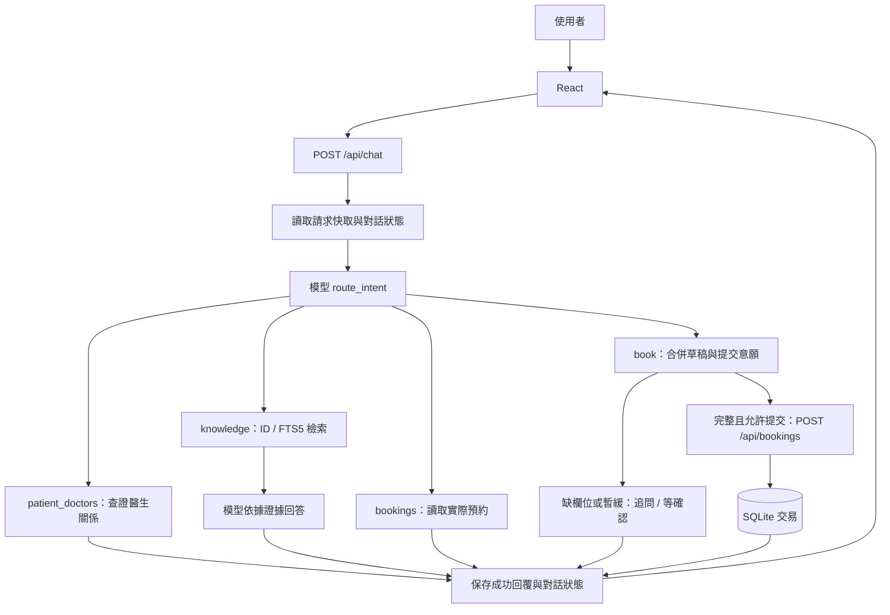

# 面試講解與問答 / Interview Walkthrough and Q&A

程式依據：本文件所在提交；最新驗收：2026-10-23；Sonnet 比較數據為 2026-10-22 歷史結果。
閱讀方式：先熟悉第 1、2、5 節，再用第 9 節模擬追問。啟動與模型參數以 [README](README.md) 為準，測試數據以 [VALIDATION](VALIDATION.md) 為準。本文描述實際程式，向量檢索與正式環境改造另列為未來方案。

---

## 1. 開場介紹：60–90 秒

> ClinicPilot 是一個診所服務導覽與對話式預約原型。使用者可以詢問醫生、服務與就診準備，也能在自然對話中逐步提供醫生、服務、日期和時間，最後真正建立預約。
>
> 前端使用 React，後端使用 FastAPI，資料由六份 CSV 初始化到 SQLite。AI 部分使用自訂編排流程：模型負責意圖辨識、上下文理解和自然語言抽取，程式負責保存草稿、驗證參數、確認提交意願，以及執行 REST 預約交易。
>
> 知識問答採用模型改寫查詢、ID 關聯查詢與 FTS5／BM25 檢索，回答附上來源。工程上加入兩層請求防重複、錯誤處理、逐字稿引文驗證和持久化模型追蹤。
>
> 最新關係查詢版本有 152 項後端和 29 項前端測試通過；先前患者醫生專項通過 127 項檢查；最新一次為 123/124，保留一筆雙語格式 502。另新增復診 100 題、醫生 100 題及指南擴展 60 題，數量和限制見最新驗收。先前完整 64 場景的 525 項為已保留的前版證據，最新完整複核以 SUBMISSION_CHECK 為準；Sonnet 的 82 項是 10 月 22 日歷史結果。這是單一病人的作業原型，我能區分已驗證能力和正式上線仍需補強的部分。

**一句英文概述：**

> ClinicPilot is a conversational clinic assistant where the language model interprets user intent, while the application owns state, validation, authorization to submit, and transactional booking execution.

如果被問開發方式，按實際情況說明 AI 輔助的範圍、你如何審閱與驗證。不要把不熟悉的設計說成自己獨立推導；面試前應親自走一次程式與示範。

## 2. 五分鐘講解順序

| 時間 | 要講甚麼 | 展示甚麼 |
|---|---|---|
| 0:00–0:45 | 使用者問題與交付目標 | 首頁、服務問答與預約列表 |
| 0:45–1:30 | 模型和業務程式的分工 | 架構圖 |
| 1:30–2:30 | 多輪欄位收集及中途問答 | 草稿、暫緩、確認提交 |
| 2:30–3:30 | 檢索來源與真實交易 | sources、tool trace、預約 ID |
| 3:30–4:15 | 冪等、驗證、錯誤及測試 | 關鍵程式碼和測試報告 |
| 4:15–5:00 | 設計取捨與擴展方向 | SQLite 限制、向量檢索評估 |

不要一開始逐個檔案介紹。先讓面試官理解「一則訊息如何變成可驗證的結果」，再打開相關程式碼。

## 3. 專案結構與責任邊界

```text
frontend/src/
  App.jsx                 聊天、草稿、預約列表、新對話與重試
  api.js                  前端 API 請求與逾時處理
  TranscriptSummary.jsx   逐字稿摘要介面
  TracePanel.jsx          模型追蹤統計與明細

backend/app/
  main.py                 FastAPI 路由、驗證、預約交易、錯誤處理
  models.py               Pydantic 請求模型
  agent.py                意圖、上下文、草稿與 REST 工具編排
  llm.py                  供應商設定、兩種 API 格式、回傳解析
  knowledge.py            FTS5/BM25、查詢擴展、ID 關聯查詢
  db.py                   建表、CSV 初始化、狀態與成功回覆保存
  answers.py              本機回答、一般就診導覽、預約排序
  patient_doctors.py       歷史／下次／草稿醫生關係與唯讀回答
  localization.py         顯示翻譯與輸入正規化
  transcripts.py          四欄摘要、原文引句驗證
  observability.py        請求與模型呼叫追蹤

backend/tests/            單元與整合回歸
frontend/src/test/        前端元件與 API 測試
scripts/                 真實模型驗收、部署檢查、Secret 準備
mock-data/               六份原始 CSV
k8s/                     Kubernetes 部署設定
```

這是**模組化的單一服務與自訂 Agent 工作流**。沒有 LangChain、沒有多個自主 Agent，也沒有 MCP server。作業允許 REST 或 MCP，本專案採 REST。

### 一次請求的架構



補充：實際程式每輪先透過 GET /api/bookings 取得最新預約，作為路由上下文；圖中 bookings 分支表示該意圖使用這些紀錄回答。請求與生成過程另由追蹤模組記錄。

## 4. RAG 原理與實作

### 4.1 資料如何進入系統

六份 CSV 分別對應診所、醫生、服務、病人、預約和就診歷史。啟動以 INSERT OR IGNORE 匯入，重啟不會覆蓋相同 ID 的現有資料。

只有 clinics、doctors、treatments 建立通用知識索引。每筆紀錄是一個文件，保存來源檔名、ID 和原始欄位。FTS 索引啟動時從資料庫重建。

**注意：修改 CSV 不會自動更新資料庫裡已存在的同 ID 紀錄。** 正式環境需增量同步與資料遷移策略。

### 4.2 如何找資料

1. 模型根據最近歷史，把當前問題改寫成獨立的 search_query。
2. 出現目錄 ID 時，查實際資料列。例如 T003 先查服務，再補對應醫生及其診所。
3. 沒有 ID 時，正規化輸入、做中英文詞彙擴展，再以 FTS5 MATCH 查詢、BM25 排序，最多取六筆。
4. 把檢索證據與完整小型目錄交給知識回答模型，以分離的 zh/en 段落生成、校驗並渲染；語言缺失或觀察到的過度否定最多修復一次。預約查詢和缺欄提示依後端狀態產生，純結束語經模型路由後不能改變草稿。

例：「那位醫生的診金多少？」必須從前文解析「那位」，檢索 D101 的 consultation_fee_usd，而不是把這句孤立地搜尋。

### 4.3 哪些說法要準確

- 這是結構化／詞彙式 RAG，目前沒有 embedding 或向量資料庫。
- 模型選擇查詢詞與 ID，實際紀錄內容由 SQLite 提供。
- source 標籤證明提供了哪些資料，不等於逐句事實已自動驗證。
- 目前路由上下文包含整份小型目錄，回答前才取相關證據。大目錄必須先縮小候選範圍。
- 不把病史和預約放入通用知識索引；它們以患者上下文或即時工具結果提供。
- 查詢沒有找到證據時不能補造診所規定；目前沒有向量相似度門檻或正式的檢索品質評估集。

## 5. 多輪意圖與四個欄位的收集

### 5.1 模型輸出的是結構，不只是文字

意圖包含 knowledge、visit_flow、bookings、patient_doctors、book、cancel_draft。route_intent 另輸出 search_query、doctor_scope、四個預約欄位、booking_action、clear_slots 與授權原文引句。患者醫生問題按主治指定、歷史就診、下次預約或草稿選擇區分，由關係查詢產生答案，不讓模型把不同關係混淆。詳細關係圖見 [TECH_DOC](TECH_DOC.md)。

```json
{
  "intent": "book",
  "doctor_scope": null,
  "search_query": null,
  "authorization_quote": "預約 D103 的 T003",
  "hold_quote": "先不要提交",
  "booking_action": "hold",
  "clear_slots": [],
  "doctor_id": "D103",
  "treatment_id": "T003",
  "booking_date": "2035-11-08",
  "booking_time": "09:30"
}
```

模型輸出仍不可信。主機檢查工具名稱、參數型別、意圖值、可清除欄位及提交動作；格式不合法最多重新生成一次。這個修復只在路由階段發生，還沒有預約副作用。供應商／憑證錯誤不做此重試。

### 5.2 記憶分為對話與結構化狀態

| 狀態 | 作用 |
|---|---|
| history | 解析指代與前文選擇；最多保存 20 則訊息，模型取最近 12 則 |
| draft | 保存 doctor_id、treatment_id、booking_date、booking_time，以及內部預約冪等鍵 |
| active | 是否在收集預約 |
| booking_hold | 使用者是否要求等待明確確認 |

12 則是訊息數，不是 12 輪問答。歷史截斷後，結構化草稿仍可保存較早的明確選擇。這不是完整長期記憶或對話摘要機制。

### 5.3 狀態合併規則

- null／本輪未提及：保留舊欄位，不自動刪除。
- clear_slots：清除使用者明確撤回的選擇。
- 新的非空值：覆寫相應欄位。
- 缺資料：回傳草稿並追問缺失欄位。
- hold：保存暫緩，不能因四欄已完整而提交。
- confirm：明確確認後解除 hold；仍需四欄完整及業務驗證。
- cancel_draft：只清草稿，不取消既有預約。

**面試例子：**

| 使用者 | 預期行為 |
|---|---|
| 我要預約 D103 的 T003，日期稍後決定 | 記醫生與服務，追問日期時間 |
| 去之前皮膚需要做甚麼準備？ | knowledge，查 T003，草稿保持 |
| 2035 年 11 月 8 日上午九點半，先不要提交 | 記日期時間，hold=true，不寫預約 |
| 日期先撤回，還沒決定 | clear_slots 清日期，不能沿用舊值 |
| 改成 2035 年 11 月 9 日，現在確認提交 | 合併日期、解除暫緩、驗證後寫入 |

日期與時區轉換由模型抽取後交由後端檢查格式及未來時間；不是專門的完整日期解析引擎。DST 歧義和更多相對日期仍需擴充驗收。

## 6. 關鍵程式碼：面試時打開這些位置

以下節錄對應上述功能版本；閱讀完整函式時仍應打開相應檔案。

### 6.1 全文檢索與 BM25

來源：[backend/app/knowledge.py](backend/app/knowledge.py)。

```python
    match = " OR ".join('"' + token + '"' for token in tokens)
    rows = db.rows("SELECT source,record_id,content,bm25(knowledge) AS score FROM knowledge WHERE knowledge MATCH ? ORDER BY score LIMIT 6", (match,))
    return [{"source": r["source"], "id": r["record_id"], "data": json.loads(r["content"])} for r in rows]
```

### 6.2 草稿合併與提交控制

來源：[backend/app/agent.py](backend/app/agent.py)。

```python
            for key in action.get("clear_slots", []):
                draft.pop(key, None)
            for key in SLOTS:
                if action.get(key):
                    draft[key] = str(action[key])
            permission = action.get("booking_action")
            if permission == "hold":
                state["booking_hold"] = True
            elif permission == "confirm":
                state["booking_hold"] = False
            allowed = permission in ("submit", "confirm") and not state.get("booking_hold", False)
            missing = [key for key in SLOTS if not draft.get(key)]
```

### 6.3 預約交易與冪等鍵

來源：[backend/app/main.py](backend/app/main.py)。

```python
        with db.connect() as c:
            c.execute("BEGIN IMMEDIATE")
            previous = c.execute("SELECT * FROM booking_keys WHERE id=?", (body.request_id,)).fetchone()
            if previous:
                if previous["payload"] != payload:
                    raise HTTPException(409, "此請求編號已用於不同預約內容。 / Request ID already used for different booking details")
                ident = previous["booking_id"]
```

### 6.4 成功聊天的重試快取

來源：[backend/app/main.py](backend/app/main.py)。

```python
        async with app.state.lock:
            prior = db.rows("SELECT * FROM requests WHERE id=?", (key,))
            if prior:
                if prior[0]["payload"] != payload:
                    raise HTTPException(409, "此請求編號已用於另一則訊息。 / Request ID already used for another message")
                mark_outcome("cached", cached=True)
                return json.loads(prior[0]["response"])
            state = db.state(body.session_id)
```

### 6.5 有上限的路由格式恢復

來源：[backend/app/agent.py](backend/app/agent.py)。

```python
    async def route(self, message, state, context):
        if self.mode != "llm":
            return await self._route_once(message, state, context)
        for attempt in range(2):
            try:
                return await self._route_once(message, state, context)
            except ProviderError:
                raise
            except (ValueError, KeyError, TypeError, IndexError) as error:
                # Routing has no side effects. Retry only invalid structured output,
                # never provider/authentication failures or a completed booking.
                self.llm_calls.append({"tool": "route.validation", "status": "rejected",
                                       "error_code": "invalid_router_output"})
                if attempt:
                    raise ProviderError("invalid_router_output") from None
```

### 說明這些程式碼時的重點

1. **檢索**：參數化查詢傳入 MATCH 表達式；不是把使用者內容直接拼成 SQL。BM25 是關鍵詞相關性排序。
2. **草稿**：先清撤回欄位，再合併新值，然後檢查提交意願與缺失值。完整資訊和提交授權是兩件事。
3. **交易**：BEGIN IMMEDIATE 之後，在同一交易核對預約鍵與新增紀錄。相同鍵、不同內容回 409。
4. **聊天重試**：相同 session/request 及內容回原成功結果，避免再次呼叫模型；失敗請求不被當成成功快取。
5. **模型重試**：只修復路由結構，最多兩次嘗試；不是對整個包含寫入的流程任意重跑。

REST 工具透過 HTTPX ASGITransport 呼叫同一個 FastAPI 應用。這會走 HTTP 請求物件、路由、Pydantic 和交易，但不是跨服務網路呼叫。

預約成功確認直接根據 API 結果生成，不再要求模型重新表態。即使後續聊天狀態保存失敗，原請求再次執行時也依賴交易內的預約鍵防止重複建立。

## 7. 摘要、可觀測性與驗證

### 7.1 逐字稿摘要

輸入是已轉成文字的醫病對話，沒有音訊轉文字。工具提取 chief_complaint、diagnosis、medication、doctor_instructions，並為非空值提供原文 evidence。

主機檢查四欄結構、缺失 null、引文是否為原文子字串。失敗最多修復一次。來源引文吻合不代表診斷語義或否定詞理解一定正確，仍需人工審查。

### 7.2 LLM 追蹤

每個 chat／summary 請求有父 trace，route／answer／summary 呼叫是子 span。紀錄耗時、模型、介面、Token、安全錯誤分類與快取命中，保存在 SQLite。

這是內建本機追蹤，沒有 Langfuse 外部平台。追蹤表不保存提示、逐字稿或憑證；sessions／requests 仍保存聊天資料。未提供用量時顯示未知，不假裝為零；沒有價格計算。

### 7.3 如何引用驗收結果

完整結果以 [VALIDATION](VALIDATION.md) 為準；兩模型數據與方法見 [MODEL_COMPARISON](MODEL_COMPARISON.md)。面試可概述「138 項自動化測試通過、DeepSeek 本次 82 項核心檢查通過，Sonnet 有 82 項歷史驗收」，同時交代驗收日期和有限樣本邊界。

82 是斷言數，不是 82 個獨立臨床案例。耗時不是普遍性能排名；供應商、API、分詞器及推理行為不同，Token 不代表可直接比較的費用。Docker／Kubernetes 僅離線設定驗證，雲端 CI 沒有本版成功證據。

## 8. 設計取捨與擴展方案

| 選擇 | 當前理由 | 代價／未來方向 |
|---|---|---|
| FastAPI＋自訂 Agent | 模組清楚、少依賴、易驗證副作用 | 流程複雜後需更明確的狀態機或工作流引擎 |
| SQLite | 單機部署與持久化簡單 | 單 process/worker；正式多人部署考慮 PostgreSQL |
| 全域聊天鎖 | 保護本機共享 Agent 狀態與會話變更 | 不同 session 也排隊；需改成請求級資料及每會話鎖 |
| FTS5／ID 檢索 | 小目錄、精確資料與可解釋性 | 口語同義詞召回有限；評估混合檢索 |
| 最近訊息＋結構化草稿 | 控制上下文成本、保留交易狀態 | 不是完整長期記憶 |
| API 結果決定成功 | 不讓模型自稱已落庫 | 成功回覆較固定，但更容易核對 |
| auto 工具選擇＋主機驗證 | 適配 Poe／DeepSeek 實際支援 | 模型可能不按格式輸出；需拒絕或有限修復 |
| 單副本 Kubernetes | 配合 SQLite 和程序鎖 | 不是高可用／可橫向擴展架構 |

### 若增加向量檢索

以下是 2026-10-22 討論的未實作候選；採用前應再核對供應商文件及實測。

**建議先比較 Qwen3-Embedding-0.6B 與現有方法，BGE-M3 作第二個開源基線。** 若希望用 API 減少部署工作，可評估 voyage-4-lite。這些模型尚未在本專案測試，不能說加入後必然更準。

- [Qwen3-Embedding-0.6B](https://huggingface.co/Qwen/Qwen3-Embedding-0.6B)：多語言、最高 1024 維、32K 上下文；按官方建議處理 query instruction。
- [BGE-M3](https://huggingface.co/BAAI/bge-m3)：多語言、1024 維、8192 tokens；支援 dense／sparse／multi-vector。
- [Voyage 官方模型文件](https://docs.voyageai.com/docs/embeddings)：voyage-4-lite 為延遲與成本取向的 API 候選，需另設憑證。

建議演進流程：

```text
明確 ID → SQL 精確查詢
一般問題 → BM25 + dense embedding
         → 排名融合（例如 RRF）與去重
         → 必要時 reranker
         → 按來源 ID 取最新資料
         → 模型根據證據回答
```

不要直接相加 BM25 分數和 cosine similarity，兩者尺度不同。RRF 可先按排名融合，但仍要調參和評估。

文件先以一筆目錄紀錄為單位，轉成名稱、專科、介紹、服務準備等可讀文字，保存 source_id、model_version、dimension、content_hash。同一索引的查詢與文件要使用匹配模型／維度；更換模型通常需要重建索引。

小資料量可先直接做向量相似度計算，無需立刻引入額外資料庫。價格、病人權限、當前預約和交易仍走 SQL／API，不由向量相似度決定。

準備繁中、簡中、英文及口語題庫，標註正確來源，比較 Recall@k、MRR／nDCG、無答案案例、回答依據和延遲。現有 82 項流程驗收不能取代檢索評估。

## 9. 面試官可能追問：參考回答

### Q1：你的 Agent 和一般聊天機器人有何不同？
它保存結構化草稿，能根據意圖呼叫工具並產生資料庫副作用；不只是生成文字。流程是受控的自訂編排，並非任意自主規劃。

### Q2：沒有向量資料庫也叫 RAG？
可以。RAG 的核心是檢索外部資料再生成回答，檢索不限定向量。我用 ID 和詞彙檢索；是否增加 dense retrieval 應由資料和評估決定。

### Q3：模型已看過整份目錄，檢索還有甚麼價值？
目前目錄很小，整份目錄用於解析選擇與 ID；回答階段檢索相關證據，降低不相關內容。這也是限制：資料變大時，路由之前就要取候選，否則上下文成本不會因新增向量索引而自動下降。

### Q4：怎麼理解「就剛才那位」？
把最近對話和當前草稿交給模型，由模型將指代解析成已存在的 ID。後端仍驗證 ID。超出保留歷史或有多個候選時應追問，不能宣稱所有指代都能正確理解。

### Q5：使用者中途換話題，預約會丟失嗎？
knowledge 和 visit_flow 分支不清除草稿；下一輪仍提供草稿和歷史。只有明確取消草稿或成功提交才清理相關狀態。

### Q6：四個欄位都有，為甚麼不直接建立？
資訊完整不代表現在同意提交。booking_hold 會跨輪保存，只有明確 confirm 才解除。這是實測發現後加入的業務保護。

### Q7：模型輸出 JSON 就安全了嗎？
不安全。合法 JSON 可能有錯誤 ID、錯誤意圖或未授權動作。先驗證結構，再驗證業務條件和提交狀態；語義錯誤還要靠測例評估。

### Q8：為甚麼 strict=false？
是供應商工具介面的相容設定，不代表主機停止驗證。供應商支援的 schema 功能不同，所以應用端仍檢查輸出並驗證預約。

### Q9：為甚麼只重試一次？
無上限重試會增加延遲與費用，且可能掩蓋持續問題。路由重試沒有交易副作用，第二次仍錯就明確失敗；不重試整段已可能寫入的流程。

### Q10：重試怎麼避免重複預約？
聊天成功結果依 session/request 快取；預約交易另有唯一 booking key。同鍵同內容返回原預約，不同內容回 409。不能只靠前端停用按鈕。

### Q11：先寫入預約，保存聊天結果時卻失敗，怎麼辦？
使用者以原 session/request 重試；穩定的預約鍵可命中原交易，不再新增。必須承認聊天保存與預約保存不是同一個大型交易，恢復依靠冪等設計。

### Q12：async def 就能支援高併發？
不能。現在有全域聊天鎖，且 SQLite 呼叫是同步的；外部模型等待也影響吞吐。多用戶版要拆除共享請求狀態、使用每會話協調、適合併發的 DB 和容量測試。

### Q13：為甚麼不用 MCP？
原題允許 REST 或 MCP，REST 足以展示工具調用、驗證與持久化。若工具要提供給多種 Agent 客戶端，再評估 MCP；不是為了名詞增加一層。

### Q14：推薦的醫生真的能做那項服務嗎？
原資料沒有醫生服務關聯表，目前以 MATCHES 的示範假設初始化具外鍵的 doctor_treatments；檢索、路由與預約校驗再讀取此表。這不代表已驗證醫生排班，正式系統仍需可靠的服務配置及排班資料。

### Q15：如何處理時段衝突？
題目假設時段可用，目前沒有衝突檢查。正式系統需要交易內的排班檢查或唯一約束及資源預留，不能只在模型提示中要求避免衝突。

### Q16：怎麼防止模型編造成功？
模型只提出結構化意圖。真正寫入由 booking API 完成，成功確認取 API 結果和 booking ID。這能約束交易成功聲明，但不等於所有問答內容都已被機器證明正確。

### Q17：如何防提示注入？
把使用者與資料庫文字當作不可信資料，限制意圖、工具、可用患者、欄位與業務操作，並做注入案例測試。提示不是完整防護；目前沒有任意程式執行或自由 SQL 工具，正式環境仍需身份與授權。

### Q18：逐字稿摘要可靠嗎？
會驗證欄位和引文來源，缺失資訊保持 null；但引文存在不保證推論、否定詞或醫療語義正確。它是輔助整理，不是診斷系統，仍需人工核對。

### Q19：DeepSeek 比 Sonnet 好嗎？
10 月 22 日對照中兩者均通過 82 項；當時 DeepSeek 平均耗時較短。10 月 23 日的新修正僅對 DeepSeek 重跑，不把 Sonnet 舊數據當成新版本實測。但只有一組有限樣本，API、供應商和 tokenizer 也不同，不能據此給出通用品質或成本排名。

### Q20：之前 502 的根因是甚麼？
可確認的問題有設定混用和 DeepSeek thinking mode 不接受 forced tool choice；已修正載入優先序及供應商相容預設。歷史上部分 generic ValueError 沒有足夠細節，不能把它們全歸因於同一欄位；新增了有上限的路由格式恢復及測試。

### Q21：你怎麼證明真的呼叫了大模型？
獨立的 live acceptance 使用真實憑證與隔離 DB，保留 provider metadata、用量、請求結果並核對實際資料；它和 mock 單元測試分開。畫面標示模式，但健康端點顯示模型設定本身不是連線成功證明。

### Q22：追蹤會洩漏病人內容嗎？
追蹤表只存執行中繼資料，但對話表仍保存聊天內容，LLM 模式也會向選定供應商傳送必要上下文。不能說整個應用沒有敏感資料；正式使用需要資料最小化、保留政策與存取控制。

### Q23：可以直接部署 Kubernetes 多副本嗎？
不可以。現在是單副本 Recreate，配合 SQLite 和程序內鎖。多副本需先處理會話併發、共享資料庫和請求級狀態；容器化本身不會讓架構變成分散式安全。

### Q24：下一步最值得做甚麼？
先建立固定的路由／檢索評估集和錯誤分類，再改善身份授權、資料保留、並行處理和排班。如果資料量增加且檢索召回不足，再用混合檢索與基線對照，避免只靠換模型。

## 10. 現場示範與誠實邊界

### 建議示範順序

1. 確認 /api/health 模式與模型，並做一則真實提問；不要把設定成功當成供應商可用。
2. 問「我到醫院的流程」，展示繁英回答與來源。
3. 問皮膚服務推薦，再接受明確推薦，讓草稿收集欄位。
4. 中途問準備事項，展示問答後草稿不消失。
5. 提供未來日期時間並說「先不要提交」，展示沒有新增紀錄。
6. 明確確認，核對預約 ID、列表與重啟持久化。
7. 展示摘要缺失欄位 null、追蹤模型用量與安全錯誤。
8. 使用隔離測試 DB；不要把演示預約加入需要保留的正式資料。

### 不要過度宣稱

- 已做 RAG，但還沒有向量檢索。
- 已有真實模型驗收，但不是完整醫療品質認證。
- 已有引用，但沒有逐句自動事實驗證器。
- 固定 P001，沒有登入、多租戶或正式授權系統。
- 可以取消草稿，不能取消／改期已確認預約。
- 沒有排班衝突檢查、音訊轉文字或 Langfuse 整合。
- Docker／Kubernetes 設定已提供，不宣稱叢集實際驗收成功。
- 不要把 82 個檢查說成 82 個獨立臨床案例或 82 輪對話。

### 面試前自己至少能做到

- 指出一則訊息從 App.jsx 到交易落庫的完整路徑。
- 解釋 null、clear_slots、hold、confirm 的不同。
- 說明兩層冪等如何處理「已寫入但回覆失敗」。
- 能親自跑一個新增／修正測試並讀懂失敗原因。
- 清楚說明使用 AI 輔助開發的範圍與驗證方法。
- 不打開或展示 .env、1.env、Secret 或帶有私密內容的原始報告。

## 11. 對照文件

- [SUBMISSION_CHECK.md](SUBMISSION_CHECK.md)：最新複核與實際發現
- [README.md](README.md)：啟動與介面
- [VALIDATION.md](VALIDATION.md)：統一測試結果與驗證範圍
- [TECH_DOC.md](TECH_DOC.md)：技術設計
- [MODEL_COMPARISON.md](MODEL_COMPARISON.md)：兩模型完整驗收與限制
- [MAINTENANCE.md](MAINTENANCE.md)：備份、故障與測試
- [OBSERVABILITY.md](OBSERVABILITY.md)：追蹤欄位與保留策略
- [DEPLOYMENT.md](DEPLOYMENT.md)：容器與 Kubernetes
- [REQUIREMENTS_REVIEW.md](REQUIREMENTS_REVIEW.md)：原始需求對照
