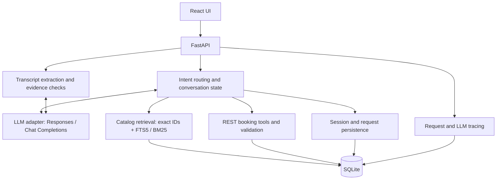

# ClinicPilot AI

**讓每一次複診，更輕鬆。 / Making every follow-up visit easier.**

診所助理作業專案：以對話查詢診所與服務、了解現有預約，並收集醫生、服務、日期與時間，完成可持久保存的預約。介面與固定回覆採繁體中文／English 對照。

A clinic assistant take-home project for grounded service Q&A, existing appointment lookup and conversational booking. It combines a React interface, FastAPI, SQLite and a configurable LLM adapter, with paired Traditional Chinese and English interface text and fixed replies.

**技術 / Stack:** React · Vite · FastAPI · SQLite FTS5 · Responses / Chat Completions

## 導覽 / Contents

- [核心功能 / Features](#features)
- [快速開始 / Quick start](#quick-start)
- [模型設定 / Model configuration](#model-configuration)
- [架構與原理 / Architecture](#architecture)
- [示範流程 / Demo walkthrough](#demo)
- [測試與驗證 / Testing](#testing)
- [部署與限制 / Deployment and scope](#deployment-and-scope)
- [API 與專案結構 / API and source map](#api-and-source-map)
- [文件索引 / Documentation](#documentation)

<a id="features"></a>
## 核心功能 / Features

| 功能 / Feature | 實作內容 / Implementation |
|---|---|
| 知識問答 / Grounded Q&A | 查詢診所、醫生、療程與政策，附資料來源與記錄 ID。 / Answers from catalog records with source labels and record IDs. |
| 個人化引導 / Personalized guidance | 使用固定模擬病人 P001 的過敏、病史與預約資訊。 / Uses the predefined mock patient's allergies, history and appointments. |
| 多輪預約 / Conversational booking | 收集、修正或撤回醫生、服務、日期及時間；中途問答保留草稿，明確暫停提交時等待確認。 / Collects and updates booking fields, preserves drafts across questions and respects requests to wait. |
| 真實資料寫入 / Persistent appointments | 經 REST 驗證並寫入 SQLite；請求重試去重，前端更新預約列表。 / Validated REST writes, retry deduplication and refreshed booking lists. |
| 文字逐字稿摘要 / Transcript summary | 主訴、診斷、用藥及醫囑四欄摘要，附原文引句；未提及內容為 null。 / Four fields with verbatim evidence; missing information remains null. |
| 模型追蹤 / LLM tracing | 記錄請求、模型呼叫、耗時、Token、快取與安全錯誤分類。 / Persistent request and model-call metadata, latency, token usage, caching and safe error categories. |

<a id="quick-start"></a>
## 快速開始 / Quick start

### 1. 環境需求 / Prerequisites

- Python 3.10+（實測 / tested: 3.13）
- Node.js 22.12+ 與 / and npm（實測 / tested Node: 22.15）
- 首次安裝需網路；埠 8000 須可用，已佔用時見下方替代埠命令。 / Internet for installation; use the alternate-port command below if port 8000 is occupied.
- Windows 建議使用短路徑，例如 D:\ClinicPilot。過長路徑可能使 Kubernetes 測試依賴安裝失敗。 / Use a short Windows checkout path; long paths can prevent installation of Kubernetes validation dependencies.

### 2. 取得並啟動 / Clone and launch

```powershell
git clone https://github.com/gjtjx/KUDOS.git
cd KUDOS
.\setup.cmd
.\start.cmd
```

Windows 也可依序雙擊 `setup.cmd`、`start.cmd`。安裝程式建立虛擬環境、安裝相依套件並建置前端。保留伺服器視窗，按 Ctrl+C 停止。

On Windows, you can also double-click the two scripts in order. Setup creates a virtual environment, installs dependencies and builds the frontend. Keep the server window open; press Ctrl+C to stop it.

- 應用程式 / Application: [http://127.0.0.1:8000](http://127.0.0.1:8000)
- API 文件 / Interactive API docs: [http://127.0.0.1:8000/docs](http://127.0.0.1:8000/docs)

首次啟動建立 `runtime/clinic.db` 並匯入六份 CSV；後續啟動保留預約與對話狀態。全新安裝預設為 **local 示範模式**，不需要 API Key，也不呼叫真實模型。要啟用 LLM，完成下節設定後重新啟動。

The first startup seeds six CSV datasets into `runtime/clinic.db`. Later starts preserve appointments and conversation state. Fresh installations default to **local demo mode**, which requires no API key and makes no live model calls. Configure LLM mode below and restart to enable a provider.

<details>
<summary>手動安裝與開發 / Manual setup and development</summary>

在專案根目錄執行 / Run from the project root:

```powershell
python -m venv .venv
.\.venv\Scripts\python.exe -m pip install -r backend\requirements.txt
cd frontend
npm.cmd ci
npm.cmd run build
cd ..
.\.venv\Scripts\python.exe -m uvicorn app.main:create_app --factory --app-dir backend --host 127.0.0.1 --port 8000
```

macOS/Linux 使用 `python3`、`.venv/bin/python` 及 `npm` 取代相應命令；其他作業系統尚未驗收。開發時保持後端運行，在 `frontend/` 執行 `npm run dev`；Vite 將 `/api` 代理至 8000 埠。

On macOS/Linux, substitute `python3`, `.venv/bin/python` and `npm`; those platforms have not been validated. For development, keep the backend running and run `npm run dev` inside `frontend/`. Vite proxies `/api` to port 8000.

</details>

若 8000 已有其他服務，安裝完成後可從根目錄改用 8018，不必停止原服務： / If port 8000 is occupied, use another port after setup:

```powershell
.\.venv\Scripts\python.exe -m uvicorn app.main:create_app --factory --app-dir backend --host 127.0.0.1 --port 8018
```

改開 [應用程式 / App](http://127.0.0.1:8018) 及 [API 文件 / API docs](http://127.0.0.1:8018/docs)。 / Open the matching port in your browser.

<a id="model-configuration"></a>
## 模型設定 / Model configuration

| 模式 / Mode | 行為 / Behavior |
|---|---|
| `AI_MODE=local` | 決定性的關鍵詞檢索、雙語意圖／欄位規則與模板回覆，適合免密鑰示範。 / Deterministic retrieval, bilingual routing/slot rules and templated answers for a key-free demo. |
| `AI_MODE=llm` | 每則新訊息由真實模型辨識意圖、抽取欄位及生成有依據的回答；預約結果由 REST 回傳決定。 / Live model routing, extraction and grounded responses; REST results determine booking outcomes. |

兩種模式共用預約 API 與資料庫。模型失敗會明確回報，不會悄悄改用本機模板。 / Both modes share booking APIs and storage. Provider failures are explicit, with no silent local fallback.

### 設定檔 / Configuration file

在專案根目錄建立 `.env`，填入同一供應商的完整設定。以下 Key 僅為佔位文字。 / Create `.env` in the project root with one complete provider profile. The key below is a placeholder.

```dotenv
AI_MODE=llm
LLM_API_KEY=your_api_key_here
LLM_BASE_URL=https://api.deepseek.com
LLM_MODEL=deepseek-flash
LLM_API_STYLE=responses
LLM_TOOL_CHOICE=auto
LLM_STRICT_TOOLS=false
LLM_TIMEOUT_SECONDS=90
```

啟動只自動讀取 `.env`；程序環境變數優先，不再載入 `.env.local`。修改後須重啟。不要提交密鑰；`.env` 與其他憑證檔已排除於 Git 及容器建置內容之外。

Startup loads `.env` only; process environment variables take precedence. `.env.local` is not loaded. Restart after changes. Credential files are excluded from Git and container build context; never commit keys.

### 已驗證的組合 / Tested provider profiles

| 設定 / Setting | DeepSeek | Poe / Claude |
|---|---|---|
| `LLM_BASE_URL` | `https://api.deepseek.com` | `https://api.poe.com/v1` |
| `LLM_MODEL` | `deepseek-flash` | `claude-sonnet-5.5` |
| `LLM_API_STYLE` | `responses` | `chat_completions` |
| `LLM_TOOL_CHOICE` | `auto` | `auto` |
| `LLM_STRICT_TOOLS` | `false` | `false` |

切換時一併更換對應密鑰。Poe 此模型在實測中拒絕 Responses 與強制工具選擇；DeepSeek 的實測設定也不接受強制工具選擇。應用仍會驗證工具名稱、參數與業務規則。這些是已測供應商組合的結果，不代表所有平台上的同名模型均相容。

Switch credentials together with the provider profile. The tested Poe route rejected Responses and forced tool choice; the tested DeepSeek configuration also rejected forced tool choice. The application still validates tool names, arguments and business rules. See [MODEL_COMPARISON.md](MODEL_COMPARISON.md) for evidence and limitations.

<a id="architecture"></a>
## 架構與原理 / Architecture



1. **檢索 / Retrieval:** 六份 CSV 初始化關聯資料；診所、醫生與療程建立 FTS5 索引。模型改寫查詢，後端以精確 ID 或 BM25 取出證據，再生成回答。目前沒有向量嵌入或向量資料庫。 / Catalog records support exact-ID lookup and lexical retrieval; selected evidence grounds answers. No dense embeddings or vector database are implemented.
2. **對話 / Conversation:** 模型輸出結構化意圖與欄位，後端管理持久化草稿、欄位撤回、暫停及確認。中途查詢不丟失預約進度。 / Structured model output is combined with persisted draft state, explicit field clearing and submission controls.
3. **寫入 / Booking:** REST 驗證醫生、服務相容性及診所當地日期時間；交易與冪等鍵避免相同請求重複建立預約。 / REST validation and transactional idempotency protect booking writes. Success messages come from saved results.
4. **摘要與追蹤 / Summary and tracing:** 摘要驗證四欄結構及原文引句；本機追蹤保存模型呼叫中繼資料。 / Summary output is checked against transcript evidence; local traces retain call metadata.

小型目錄目前完整提供給意圖路由模型，回答階段再使用選定證據；資料量擴大時需先檢索候選。架構與取捨詳見 [TECH_DOC.md](TECH_DOC.md)。 / Routing currently receives the small catalog in full; larger catalogs would require candidate retrieval before routing.

<a id="demo"></a>
## 示範流程 / Demo walkthrough

使用相對於示範當天的未來日期，時間以所選診所當地時間為準。 / Use a future date; times are local to the selected clinic.

| 步驟 / Step | 輸入或操作 / Input or action | 預期結果 / Expected result |
|---|---|---|
| 1. 就診引導 / Visit guidance | 「我到醫院的流程」 / “What should I expect when visiting the clinic?” | 有依據的引導與現有預約資訊。 / Grounded guidance and appointment context. |
| 2. 服務查詢 / Service Q&A | “I have a skin rash. What service is available?” | 目錄內的服務建議與來源。 / Catalog-based suggestions with sources. |
| 3. 查詢預約 / Existing bookings | “When is my next appointment?” | 讀取資料庫中未來且已確認的預約。 / Reads future confirmed bookings. |
| 4. 多輪收集 / Slot collection | 新對話：“I want to book an appointment.” → “Dr. Sarah Jenkins for a checkup.” | 收集醫生與服務，再追問日期時間。 / Selects doctor/service and asks for missing fields. |
| 5. 儲存與重載 / Save and reload | 輸入未來日期時間，例如 “2035-11-08 at 9:30 am”。 / Supply a future date and time. | 有效且獲授權的完整草稿寫入；更新列表，重載後仍存在。 / A valid, authorized draft is saved and persists after reload. |
| 6. 摘要與追蹤 / Summary and tracing | 啟用 LLM 後開啟逐字稿摘要、貼上文字，再查看模型使用紀錄。 / In LLM mode, paste a transcript and inspect model activity. | 四欄摘要、引句及請求／模型呼叫紀錄。 / Four summary fields, evidence and traces. |

LLM 模式可另測「先不要提交」、撤回日期、插入服務準備事項問題，再確認提交。推薦本身不代表同意預約；取消草稿不會取消已建立的預約。

In LLM mode, also test holding a draft, withdrawing a date and asking a preparation question before confirming. A recommendation alone does not authorize a booking. Cancelling a draft does not cancel an existing appointment.

Local 模式的日期、名稱及問法較有限；支援 ID、基本名稱、`YYYY-MM-DD`、明天／tomorrow、`HH:MM` 及英文 AM/PM。 / Local mode supports a limited set of names, IDs and date/time expressions; use LLM mode for broader natural language.

<a id="testing"></a>
## 測試與驗證 / Testing

**2026-10-23 提交前複核通過。** 從公開 GitHub 乾淨副本完成安裝、建置、隔離啟動與瀏覽器演示，詳見 [SUBMISSION_CHECK.md](SUBMISSION_CHECK.md)。
**Submission review passed on October 23, 2026**, using a fresh public clone and isolated runtime.

| 驗證 / Validation | 結果 / Result |
|---|---|
| 後端單元／整合測試 / Backend tests | 110 passed |
| 前端單元／元件測試 / Frontend tests | 28 passed |
| 前端正式建置 / Production build | Passed |
| DeepSeek 完整流程 / Live core acceptance | 82/82 checks, 2026-10-23 |
| DeepSeek 暫緩／撤回 / Hold and withdrawal cases | 27/27 checks, 2026-10-23 |
| 常見問法 / Common questions | 20 replies reviewed; 84/84 mechanical checks; two minor wording observations in the review report |
| Poe Sonnet 歷史對照 / Historical Sonnet acceptance | 82/82 checks, 2026-10-22; 本次未重跑 / not rerun in this review |

本次發現並修正本機詞彙檢索噪聲及模型對「確認醫生／服務」的過度暫緩；中間失敗報告保留。這是有限案例驗收，不是通用模型排名。雲端 CI 與容器／叢集執行仍未驗收。
The review found and corrected lexical noise and an over-cautious routing interpretation. Failed runs are retained; runtime deployment and cloud CI remain unverified.

重跑命令、覆蓋率及測試對照見 [VALIDATION.md](VALIDATION.md)。真實供應商測試見 [MODEL_COMPARISON.md](MODEL_COMPARISON.md)，會消耗 API 額度。 / Use the linked guides to reproduce local and paid live tests.

<a id="deployment-and-scope"></a>
## 部署與限制 / Deployment and scope

提供 Docker Compose 與 Kubernetes 設定，包含持久化儲存、健康檢查、非 root 執行及密鑰檔掛載。設定已離線檢查，尚未實際啟動容器或叢集。操作步驟見 [DEPLOYMENT.md](DEPLOYMENT.md)。

Docker Compose and Kubernetes manifests include persistent storage, probes, non-root execution and file-mounted secrets. They have received offline checks; container and cluster runtime have not been validated. See the deployment guide before use.

- **使用範圍 / Access:** 固定模擬病人 P001，沒有登入或多人權限；維持本機存取。 / One predefined mock patient, no authentication or multi-user access control; intended for local use.
- **預約範圍 / Booking:** 依作業假設時段可用；不含衝突檢查、既有預約取消或改期。 / Timeslots are assumed available; conflict checking and cancellation/rescheduling of saved bookings are outside scope.
- **檢索與摘要 / Retrieval and summary:** FTS5/BM25，尚無向量檢索；摘要接收最多 16,000 字元的文字，只在 LLM 模式啟用，不含錄音轉文字。 / Lexical retrieval only; summaries require LLM mode and accept text up to 16,000 characters, with no audio transcription.
- **資料與隱私 / Data:** LLM 模式將必要模擬病人、對話、目錄或逐字稿送往供應商。逐字稿不寫入應用資料庫；對話狀態會保存。追蹤表只存中繼資料。 / Necessary context is sent to the provider. Transcripts are not stored in the app database; conversations are persisted, while trace tables contain metadata only.
- **擴展與維護 / Operations:** 單 worker、單副本 SQLite；未驗證水平擴展。CSV 採缺失記錄新增，並非資料遷移系統。 / Single-worker, single-replica SQLite; no validated horizontal scaling. CSV seeding inserts missing records rather than migrating existing ones.
- **醫療邊界 / Clinical scope:** 提供服務導覽與資料摘要，不是診斷或處方系統；原文引句檢查不等於臨床驗證。 / Service navigation and summarization, not diagnosis or prescribing; evidence checks are not clinical validation.

<a id="api-and-source-map"></a>
## API 與專案結構 / API and source map

### API

| 方法與路徑 / Method and path | 用途 / Purpose |
|---|---|
| `GET /api/health` | 模式與服務狀態 / Mode and service status |
| `GET /api/live`, `GET /api/ready` | 程序／資料庫探針 / Process and database probes |
| `GET /api/profile` | P001 個人資料與病史 / Mock patient profile and history |
| `GET /api/catalog` | 診所、醫生與療程 / Clinics, doctors and treatments |
| `GET /api/bookings?patient_id=P001` | 查詢預約 / Read appointments |
| `POST /api/chat` | 多輪對話 / Conversation turn |
| `POST /api/bookings` | 驗證並建立預約 / Validate and save an appointment |
| `POST /api/transcripts/summarize` | 文字逐字稿摘要 / Summarize a transcript |
| `GET /api/observability?limit=20` | 請求與模型追蹤 / Request and model traces |

重試須沿用相同 `request_id` 與內容；相同 ID 配不同內容回傳 409。驗證失敗為 422，資料庫失敗為 503，模型失敗為 502。完整欄位見運行中的 [API 文件](http://127.0.0.1:8000/docs)。 / Reuse the same request ID and payload when retrying. Conflicting reuse returns 409; validation, database and model failures return 422, 503 and 502 respectively.

### 原始碼導覽 / Source map

```text
backend/app/
  main.py              API, transactions and frontend serving
  agent.py             Intent routing, booking state and REST tools
  knowledge.py         Catalog indexing and FTS5/BM25 retrieval
  llm.py               Provider transport and compatibility
  db.py                Schema, CSV seeding and persistence
  models.py            Request validation
  answers.py           Grounded local-mode replies and visit guidance
  transcripts.py       Summary extraction and evidence validation
  observability.py     Request traces and LLM spans
backend/tests/         Backend unit and integration tests
frontend/src/          React chat, bookings, summaries and trace viewer
mock-data/             Six supplied CSV datasets
scripts/               Live acceptance and deployment checks
k8s/                   Kubernetes manifests
Dockerfile             Multi-stage application image
compose.yaml           Local-mode Docker Compose deployment
compose.llm.yaml       LLM deployment override
```

<a id="documentation"></a>
## 文件索引 / Documentation

| 文件 / Document | 閱讀目的 / When to read |
|---|---|
| [SUBMISSION_CHECK.md](SUBMISSION_CHECK.md) | 最新提交前檢查、問題修正與演示證據。 / Latest submission-readiness review. |
| [TECH_DOC.md](TECH_DOC.md) | 理解架構、設計取捨與假設。 / Architecture, tradeoffs and assumptions. |
| [REQUIREMENTS_REVIEW.md](REQUIREMENTS_REVIEW.md) | 對照原始作業要求與完成範圍。 / Requirement-by-requirement implementation status. |
| [VALIDATION.md](VALIDATION.md) | 查看測試、覆蓋率與驗收限制。 / Tests, coverage and acceptance limits. |
| [MODEL_COMPARISON.md](MODEL_COMPARISON.md) | 查看最新 DeepSeek／Sonnet 對照及重跑方式。 / Latest provider comparison and reproduction commands. |
| [MAINTENANCE.md](MAINTENANCE.md) | 維護、備份、還原及排錯。 / Maintenance, backup, restore and troubleshooting. |
| [DEPLOYMENT.md](DEPLOYMENT.md) | Docker／Kubernetes 設定與操作。 / Container and Kubernetes setup. |
| [OBSERVABILITY.md](OBSERVABILITY.md) | 追蹤欄位、保留策略與隱私範圍。 / Trace fields, retention and privacy scope. |
| [LIVE_MODEL_REPORT.md](LIVE_MODEL_REPORT.md) | 歷史 Claude 實測與相容性記錄。 / Historical Claude acceptance and compatibility findings. |
| [EXTENDED_TEST_REPORT.md](EXTENDED_TEST_REPORT.md) | 歷史邊界案例、問題與修復證據。 / Historical edge cases and regression evidence. |

目前操作指南與歷史驗收報告已分開標示；歷史數量不與最新結果相加。 / Current guides and historical reports are labelled separately; their counts are not cumulative.

其他閱讀 / Additional reading:

- [SUBMISSION_REPORT_EN.md](SUBMISSION_REPORT_EN.md)：精簡英文提交摘要。 / Concise English submission overview.
- [INTERVIEW_GUIDE.md](INTERVIEW_GUIDE.md)：面試講解、程式節錄與問答。 / Interview walkthrough, code excerpts and Q&A.
