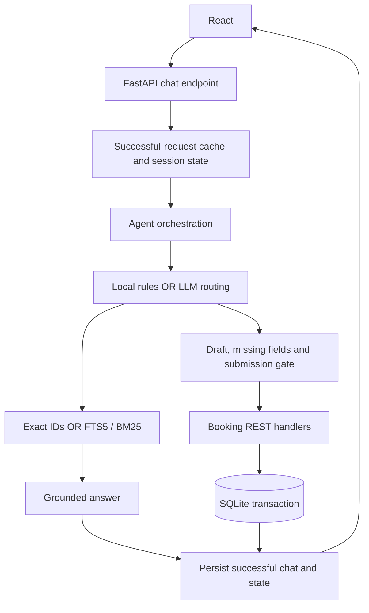
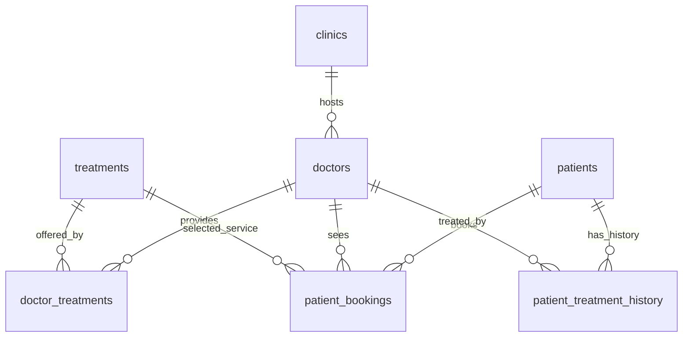

# 技術設計 / Technical Design

本文說明實際架構、狀態與交易邊界。啟動及供應商設定見 [README](README.md#model-configuration)，實測數據見 [VALIDATION](VALIDATION.md)。
This document describes the implemented design. Setup, provider profiles and acceptance evidence are maintained in the linked guides.

## 1. 架構與責任 / Architecture and responsibilities

ClinicPilot 是模組化單一服務：React 前端、FastAPI API、自訂 Python Agent 與 SQLite。作業允許 REST 或 MCP，本專案選擇 REST；沒有額外 Agent 框架或 MCP server。
ClinicPilot is a modular single service, using custom orchestration and REST tools rather than a separate AI service or MCP server.

每輪 Agent 先經 `GET /api/bookings` 讀取即時預約，另載入 P001 資料與小型目錄。工具使用 HTTPX ASGITransport 呼叫同一 FastAPI 應用，經正式路由、Pydantic 與交易；不是跨服務網路請求，也不是直接繞過 API 寫資料庫。
Each turn reads current bookings through REST. ASGITransport dispatches through the actual API handlers within the process.

| 模組 / Module | 責任 / Responsibility |
|---|---|
| [main.py](backend/app/main.py) | API、錯誤處理、交易與前端服務 / API, errors, transactions, static serving |
| [generation.py](backend/app/generation.py)、[conversation.py](backend/app/conversation.py) | 雙語結構校驗、有限修復、結束語狀態保護及合資格選項 / Validated bilingual generation and conversation invariants |
| [agent.py](backend/app/agent.py) | 路由、上下文、草稿與工具編排 / Routing, context, drafts, tools |
| [patient_doctors.py](backend/app/patient_doctors.py) | 區分主治指定缺失、歷史／下次／草稿醫生 / Verified relationship facts and scoped identity answers |
| [knowledge.py](backend/app/knowledge.py) | ID 關聯查詢、FTS5/BM25 / Catalog retrieval |
| [llm.py](backend/app/llm.py) | Responses / Chat Completions、相容設定及安全錯誤 / Provider adapter |
| [db.py](backend/app/db.py)、[models.py](backend/app/models.py) | 持久化、初始化及輸入驗證 / Persistence, seed, input validation |
| [answers.py](backend/app/answers.py)、[localization.py](backend/app/localization.py) | 本機回答與雙語顯示 / Local answers and localization |
| [transcripts.py](backend/app/transcripts.py) | 摘要與引文驗證 / Summary and evidence checks |
| [presentation.py](backend/app/presentation.py) | 生成文字的繁體、換行與姓名顯示正規化；不修改原文引句 / Display normalization, leaving verbatim evidence unchanged |
| [observability.py](backend/app/observability.py) | 請求與模型追蹤 / Request and generation traces |
| [frontend/src](frontend/src) | 聊天、預約、摘要、追蹤與重試 / React workbench |

## 2. 路由與對話狀態 / Intent and conversation state

`local` 是獨立示範模式，以規則與模板運行；`llm` 每則新訊息使用模型路由，失敗不自動降級成本機回答。
Local mode is an explicit deterministic demo, not an automatic fallback for provider failures.

| 意圖 / Intent | 行為 / Behavior |
|---|---|
| `knowledge` | 檢索並回答，包括特定服務準備事項；保留草稿 / Retrieve and answer without clearing the draft |
| `visit_flow` | 一般就診導覽；未提供的院內規定標為未知 / General visit guidance with explicit information gaps |
| `bookings` | 使用 REST 取得的即時預約 / Answer from current booking records |
| `patient_doctors` | 依 doctor_scope 查患者醫生關係，不列出整份預約 / Scoped patient-doctor identity, not a full booking dump |
| `book` | 合併選擇、追問缺失欄位或提交 / Merge, clarify or execute |
| `cancel_draft` | 清除未提交草稿；不修改已確認預約 / Discard only the pending draft |

Session 綁定 P001，保存 `active`、`draft`、`booking_hold` 和最多 20 則歷史訊息；模型使用最近 12 則歷史訊息。這是訊息數，不是問答輪數；結構化草稿可保留更早的選擇。
Sessions retain bounded history and structured booking state, not unlimited conversational memory. After actual model routing, narrowly matched pure closing messages preserve booking state; mixed closing/new instructions are not intercepted. Missing-field service options exclude adult-ineligible T002, matching the existing API rule.

`route_intent` 輸出意圖、`search_query`、`doctor_scope`、四欄位、`clear_slots`、`booking_action`，以及可回溯使用者原文的 `authorization_quote`／`hold_quote`。主機驗證引文來源；具授權依據的完整、未暫緩草稿可修正誤判的 collect；既有 hold 不會因此解除。主機依序處理：
The host processes the routing result in this order:

1. 清除明確撤回的欄位；null／未提及不刪舊值。 / Clear explicitly withdrawn fields; absent/null values preserve selections.
2. 合併新的醫生、服務、日期與時間。 / Merge new slot values.
3. 保存 hold；只有 confirm 解除暫緩。 / Persist a hold until explicit confirmation.
4. 缺欄位或無提交許可時不寫入；只有完整且獲授權的草稿進入 API。 / Execute only a complete, authorized draft.
5. 成功或取消草稿後清理待辦狀態。 / Clear pending state on success or draft cancellation.

主機檢查工具回傳與允許的欄位／動作。路由結構錯誤最多修復一次，發生在預約副作用之前；供應商或憑證錯誤不走此修復。Provider 的 `strict=false` 不會停用應用驗證，也不能保證模型語義正確。
Invalid routing structure allows one bounded retry before side effects. Host validation remains active regardless of provider strict-mode support.

## 3. RAG 與資料依據 / Retrieval and grounding

- 診所、醫生、療程每列建立一份知識文件，保存來源檔名、ID 與資料。 / Each catalog row becomes a document with source identity.
- 模型依最近歷史改寫查詢、解析指代；有目錄 ID 時查真實資料列並補相關醫生／診所。 / Contextual query rewriting precedes exact-ID retrieval.
- 無 ID 時做雙語詞彙擴展、去除停用詞，以參數化 FTS5 MATCH 查詢、BM25 排序，最多六筆。 / Otherwise use lexical retrieval, limited to six ranked results.
- 回答模型根據檢索內容生成；病史與預約另外注入，不進通用知識索引。 / Patient context is separate from the general knowledge index.

目前沒有 embedding、向量資料庫或 reranker。路由與知識回答均看到完整小型目錄；回答另外使用選定證據，避免把局部檢索缺失當作整份目錄缺失。大資料量應先取候選並標明檢索範圍。來源標籤不等於每句生成內容已自動驗真。
本輪修正內部輸出契約：模型只輸出 zh/en 段落 JSON，後端負責顯示文字，不再同時要求直接輸出文字。語言能力校驗區分「她不會說」與「這不代表她不會說」；只豁免明確否定推斷，不跨標點或轉折，仍拒絕另一句無根據的否定。最多一次修復，沒有本機答案降級。
The output contract consistently requires JSON. Language validation exempts narrowly matched negated inferences, while independent or contrasting unsupported inability claims remain rejected. The one-repair limit and explicit failure remain unchanged.

Knowledge and visit replies are generated as internal JSON zh/en paragraph pairs, validated for both languages, catalog-name/word usage and the observed unsafe negative-language/approval patterns, then rendered as text. One bounded repair is allowed; a second invalid result returns an explicit provider error. These checks do not prove translation equivalence or general semantic truth.

No dense retrieval is implemented. Full-catalog context is a scaling limitation, and citations are not sentence-level fact verification. Booking lookup, missing-field prompts and saved/rejected confirmations use authoritative backend text after real model routing; knowledge and visit guidance retain model generation.

FTS5 的優點是本機、可解釋且易驗證，代價是同義詞與口語召回有限。未來可比較 BM25 與混合檢索，但須使用標註題庫衡量召回、無答案行為及延遲，不能假定向量化必然更好。
The lexical baseline favors simplicity; hybrid retrieval remains a proposal requiring evaluation.

## 4. 資料模型與初始化 / Data model and initialization

| 表 / Table | 用途 / Purpose |
|---|---|
| `clinics`、`doctors`、`treatments` | 診所、醫生、服務目錄 / Catalog |
| `patients`、`patient_treatment_history` | 病人與就診歷史 / Patient context |
| `patient_bookings` | 原始及新建預約，關聯病人、醫生與療程 / Persistent appointments |
| `doctor_treatments` | 醫生與服務的多對多關聯；複合主鍵及兩個外鍵 / Doctor/service bridge used by retrieval and booking validation |
| `sessions` | 草稿、歷史及暫緩狀態 / Conversation state |
| `requests` | 成功聊天回覆快取 / Successful chat response cache |
| `booking_keys` | 預約請求去重 / Booking idempotency |
| `knowledge` | FTS5 虛擬表 / Full-text index |
| `request_traces`、`llm_spans` | 本機追蹤 / Observability |

每條連線啟用外鍵；輸入值使用參數化 SQL。六份 CSV 以 `INSERT OR IGNORE` 初始化：修改 CSV 不會更新既有 ID，新增預約也不回寫 CSV。FTS 索引啟動時由資料庫目錄重建。
Seeding inserts missing IDs rather than migrating existing rows. See [MAINTENANCE](MAINTENANCE.md) for safe updates and backup.

### 資料關係與患者醫生查詢 / Relationships and patient-doctor queries

原六份 CSV 沒有醫生／服務關聯表。`doctor_treatments` 為空時，以既有示範假設初始化六筆關聯；之後保留資料庫維護的非空關聯，不在每次啟動覆寫。`MATCHES` 僅是初始化預設值。檢索擴充、路由映射與預約校驗讀取同一關聯表。
The source CSVs omit the compatibility bridge. Six documented demo links seed an empty bridge; subsequent nonempty mappings remain database-maintained. Retrieval, routing context and booking validation read that table.

`db.profile()` 以 SQL JOIN 把 P001 病歷連到醫生及診所；預約經正式 REST 查詢連到醫生、服務與診所。`GET /api/patient-doctors` 回傳最近病歷醫生與依診所時區排序的下一次未來已確認預約。沒有主治指定欄位，因此 `primary_assignment` 為 null（表示資料未提供，而非證明患者沒有主治醫生）。草稿醫生只代表會話選擇，不寫成患者醫生歸屬。
SQL joins connect patient history to doctors and clinics. The read-only relationship API distinguishes recorded history from the next confirmed appointment. Null assignment means unrecorded, not proof that no primary doctor exists; a draft selection is not an assignment.

LLM 路由新增 `patient_doctors` 與 `doctor_scope`（primary、overview、history、next、draft）；其回答由已查證關係產生，避免再次生成把不同關係混為一談。模型仍先執行；狹義獨立問句另有唯讀保護，避免錯分為查整份預約或寫入。混合問句與其他醫生屬性問題仍交由路由處理；不宣稱涵蓋所有語句。
The model classifies relationship questions and their scope. Verified facts are rendered by the host; narrow standalone-question guards run after routing and preserve drafts. Mixed requests and attribute questions still use model routing.

## 5. 交易與重試 / Transactions and retries

預約及其冪等鍵在同一 `BEGIN IMMEDIATE` 交易保存。同鍵同內容返回原預約，不同內容回 409。聊天則以 session/request ID 保存成功結果，前端網路重試保留原 ID 與訊息。
Booking writes and their idempotency records are atomic; chat responses have a separate successful-request cache.

預約交易與聊天狀態保存**不是同一交易**。若預約已成功但聊天保存失敗，原請求重試透過穩定的預約鍵取得原預約，避免重複寫入。預約成功或拒絕訊息直接依 API 結果產生，不再依賴一次模型生成。
Recovery across the two transactions relies on idempotency. Booking confirmations are authoritative API results.

全域 asyncio 聊天鎖保護單程序狀態，會使不同 session 排隊；SQLite 呼叫也是同步的。多 worker／多副本需請求級狀態、每會話協調與適當共享資料庫，不能直接擴容。
The current design is single-worker, not a distributed or high-concurrency system.

## 6. 摘要、追蹤與隱私 / Summary, tracing and privacy

文字逐字稿摘要只在 LLM 模式啟用，最多 16,000 字元。四欄為主訴、診斷、用藥、醫囑；未提及為 null，非空欄位須附存在於原文的引句。無效輸出最多修復一次，仍錯則失敗。這只驗證來源，不證明臨床語義正確。
Text extraction uses an application schema and exact evidence checks; it does not perform audio transcription or clinical validation.

摘要不注入 P001，也不保存逐字稿；內容會送供應商。聊天表保存對話，追蹤表只保存中繼資料。追蹤失敗不撤銷已成功的業務操作，因此統計可能缺漏。欄位與保留策略見 [OBSERVABILITY](OBSERVABILITY.md)。
Transcripts, persisted conversations and metadata-only traces have different data-handling boundaries.

## 7. 假設與取捨 / Assumptions and tradeoffs

| 決策 / Decision | 限制 / Consequence |
|---|---|
| 固定成人 P001、無登入 / Fixed adult P001, no authentication | 僅本機示範，非多人正式服務 / Local demonstration only |
| 自訂 Agent / Custom orchestration | 流程少依賴；複雜化時需重新評估工作流管理 / Simple dependencies, explicit workflow maintenance |
| SQLite、單 worker / Single-worker SQLite | 易啟動；無水平擴展驗收 / Easy setup, no horizontal scaling |
| 顯式醫生服務映射 / Explicit compatibility mapping | 原 CSV 無關聯表，需同步維護 / Must maintain mapping with catalog changes |
| 依題目假設時段可用 / Available-slot assumption | 無衝突或營業時段檢查 / No conflict or opening-hour enforcement |
| 診所當地日期時間 / Clinic-local dates and times | C001 紐約、C002 洛杉磯，依地址推定；DST 歧義尚未完整測試 / Inferred timezones, incomplete DST coverage |

映射為 T001→D101、T002→D102、T003→D103、T004→D101/D102、T005→D104；P001 不適用兒童疫苗。新預約須為未來時間，歷史種子資料保留。Local 的 tomorrow／明天以紐約日期計算，跨時區示範宜用明確日期。
These catalog and timezone assumptions are enforced or documented independently of model output.

既有預約取消／改期、音訊辨識、外部 Langfuse、身份授權與臨床驗證未實作。部署設定及其未驗收範圍見 [DEPLOYMENT](DEPLOYMENT.md)，原始需求對照見 [REQUIREMENTS_REVIEW](REQUIREMENTS_REVIEW.md)。
